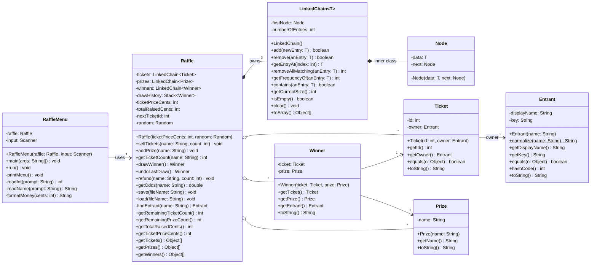

# RaffleNight

CS 2114 Project 2 (Group 54). A text-menu raffle: sell tickets, add prizes,
draw random winners, undo the last draw, refund tickets, check odds, and
save/load to a text file.

## Files

All source files are in `src/raffle`:

- `LinkedChain.java` – generic linked bag (adds at the front) with `getEntryAt` and `removeIf`
- `Raffle.java` – the raffle rules; throws on any invalid action and leaves state unchanged
- `RaffleMenu.java` – keyboard menu; contains `main`
- `Entrant.java`, `Ticket.java`, `Prize.java`, `Winner.java` – data classes

The program uses only the standard Java library.

## Class Diagram



## Requirements

Java 8 or newer (`javac` and `java` on your PATH).

## Compile

From the `RaffleNight` folder (the one containing this README):

```
javac -d bin src/raffle/*.java
```

This puts the compiled classes in `bin/`.

## Run

From the same folder:

```
java -cp bin raffle.RaffleMenu
```

The program first asks for the ticket price in cents (for example `200` for
$2.00), then shows the menu:

```
1. Sell tickets
2. Add prize
3. Draw winner
4. Undo last draw
5. Refund tickets
6. Check a person's tickets and odds
7. Show status
8. Save
9. Load
0. Quit
```

Type a number and press Enter. Invalid input prints a message and returns to
the menu. Enter `0` to quit.

## Reflection

### What changed from our specification?

**Classes.** We built the seven classes from the spec (`LinkedChain<T>`,
`Raffle`, `RaffleMenu`, `Entrant`, `Ticket`, `Prize`, `Winner`) with the
fields and public methods from the UML. Changes:

- **`Raffle.ticketPriceCents` is not `final`.** The UML marks it final, but
  `load` is supposed to replace *all* state from a file, including the price.
  Only `load` changes it; selling and refunding never do.
- **Extra private helpers** that the spec did not list: `Raffle.findTicket`
  (shared by `findEntrant` and `refund`), `Raffle.entrantFor` (so loaded
  tickets for the same person share one `Entrant`), `LinkedChain.unlink`
  (shared by `remove(T)` and `removeIf`), and `RaffleMenu.handle`,
  `printStatus`, `printList` (to keep `run()` short).
- **`Entrant` and `Ticket` override `hashCode`** to match their `equals`.
- **`Entrant`'s display name collapses runs of spaces** (`"Ana   Lee"` shows as
  `"Ana Lee"`) as well as trimming, so names line up in the status list.

**Method signatures.** All signatures in the method table were kept. The
"Generic Contract" section also mentioned `addToEnd(T)` and `get(int)`;
we did not build these because the method table is the agreed list and
`getEntryAt(int)` does the job of `get`. `RaffleMenu.main` reads the price
with its own loop instead of `readInt`, because `readInt` is an instance
method and the menu object does not exist until the price is known.

**Where validation lives.** Same as the spec: `RaffleMenu` re-prompts on
non-numbers and blank names; `Raffle` and the data-class constructors throw
`IllegalArgumentException` / `IllegalStateException`; `run()` prints the
message and returns to the menu. Additions:

- `sellTickets` rejects a sale whose total would overflow an `int`.
- `refund` also rejects a count of 0 or less, and names with no tickets.
- `load` reads the whole file before changing anything, so a missing or
  malformed file leaves the old raffle untouched.
- If input runs out (e.g. end of file), the menu ends the same way Quit does
  instead of crashing.

**Test cases.** The JUnit tests from our test plan were written (63 tests,
all passing) but are **not included in this prototype**; the repository
contains only the program source. See "What doesn't work yet".

### What changed in the LinkedChain?

Compared with the standard linked bag:

- **Added `getEntryAt(int index)`** – `drawWinner` needs to pick the ticket at
  a random position without removing it first.
- **Added `removeIf(Predicate<? super T>)`** – removes every matching entry in
  one pass. It is built for the "each person wins once" stretch goal; the
  current `Raffle` does not call it yet.
- **Changed `remove(T anEntry)`** to unlink the matching node in place instead
  of swapping in the first entry. This keeps the remaining entries in order,
  so the status list and saved files don't reshuffle after a draw or refund.
- `add`, `remove()`, `contains`, `getFrequencyOf`, `getCurrentSize`,
  `isEmpty`, `clear` and `toArray` behave like the standard bag.
  `contains` and `getFrequencyOf` are not used by the application yet.

### What happened to our unknowns?


Figured out:

- **Making a random draw testable** – pass a `Random` into the `Raffle`
  constructor; a seeded `new Random(42)` gives the same draw every run.
- **Treating "Sam Lee" and "sam lee" as one person** – `Entrant.normalize`
  builds a key (trimmed, single-spaced, lowercase) used for every comparison.
- **Undoing a draw** – a `Stack<Winner>`; undo pops the last winner and puts
  its ticket and prize back.
- **Saving and loading** – a tab-separated text file with one record per
  line (`PRICE`, `RAISED`, `NEXTID`, `TICKET`, `PRIZE`, `WINNER`). Undo
  history is rebuilt from the saved winners, so undo still works after a load.

Still open:

- How "each person wins once" should interact with undo (undo would need to
  give back *all* of the winner's removed tickets, not just the drawn one).

### What doesn't work yet?

- **"Each person wins once" is not implemented.**
- **`load` trusts the file's numbers.** It checks the format, but not that
  ticket IDs are unique or that the saved total matches the tickets, so a
  hand-edited file can load an inconsistent raffle.
- **The real program uses an unseeded `Random`**, so draws can't be replayed
  outside of tests.
- The price can only be set when the program starts (or by loading a file).

## Next Steps

### What is left to finish the MVP?

The MVP features (sell, add prize, draw, undo, status, quit) all work WE still need to

3. Tighten `load` validation (unique ticket IDs, `NEXTID` greater than every
   ticket ID, saved total consistent with tickets sold).

### Which stretch goals will we attempt?

- **Done:** refund, odds, save/load.
- **Committing to:** "each person wins once" – one `removeIf` call in
  `drawWinner`, plus storing the removed tickets on the `Winner` so undo can
  restore them.
- **Dropping:** none

### What new tests will we need?

- `LinkedChain`: every row of the test plan (`add`, both `remove`s,
  `getEntryAt` out of range, `removeIf` with null / no match, `toArray` order).
- `Raffle`: every row of the test plan, plus
  - `sellTickets` overflow (`Integer.MAX_VALUE` tickets) is rejected;
  - `refund` with count 0 and with a name that has no tickets;
  - `load` of a malformed file keeps the old state;
  - undo still works after `load`;
  - each-person-wins-once: after a draw the winner has 0 tickets, and undo
    restores all of them.
- `RaffleMenu`: no input at all, a non-number, a blank name, an unknown menu
  choice, and an error from `Raffle` (e.g. drawing with no prizes) all return
  to the menu without crashing.
- `Entrant`, `Ticket`, `Prize`, `Winner`: constructor rejections, `equals`,
  and `toString`, as in the test plan.

### Who does what?


| Item | Owner |
| --- | --- |
| Restore and run the JUnit tests | Noah K. |
| Headers and Javadoc | Vanessa |
| `load` validation | Noah R. |
| Each-person-wins-once + its tests | Jonathan |
| Final README and attribution update | Vanessa |

## Attribution


| File | Who | How |
| --- | --- | --- |
| `LinkedChain.java` | | copied from given file |
| `Raffle.java` | | GenAI-generated from our spec; reviewed by: Noah K| read over the code
| `RaffleMenu.java` | | GenAI-generated from our spec; reviewed by: Noah R| read over the code
| `Entrant.java` | | GenAI-generated from our spec; reviewed by: Vanessa| read over the code
| `Ticket.java` | | GenAI-generated from our spec; reviewed by: Noah K| read over the code
| `Prize.java` | | GenAI-generated from our spec; reviewed by: Jonathan| read over the code
| `Winner.java` | | GenAI-generated from our spec; reviewed by: Noah R| read over the code
| Test files (`LinkedChainTest`, `RaffleTest`, `RaffleMenuTest`, `RaffleDataTest`) | | GenAI-generated from our test plan; revied by: Vanessa | ran the test files
| `README.md` | | GenAI-drafted; revised by: Jonathan | filled in the gaps

**How we used GenAI.** We gave Claude (Anthropic's AI assistant) our full
written specification – class design, UML, method table with Big-O, where
validation lives, and test plan – and it generated the Java source, the
JUnit tests, and a draft of this README. It flagged the places where the spec
was ambiguous or where it departed from the spec (listed under Reflection).
We reviewed the code to ensure that it looked good and then we ran the program
ourselves to make sure that it worked as intended.
